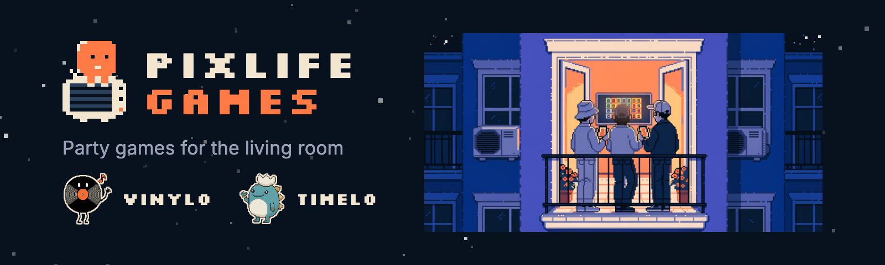

  

# Pixlife Games

We're an independent studio in Warsaw, Poland, making party games for the living room. The TV is the game board and everyone plays on their own phone. Friends join by scanning a QR code, and only the host installs the app.

## Games

**Vinylo** is a music party game. A song plays and you guess the year it came out to place it on your timeline. In the second mode you name the song after hearing 1, 3, 7 or 15 seconds of it.

[Google Play](https://play.google.com/store/apps/details?id=com.pixlife.vinylo)

**Timelo** is a history party game. A narrator reads out a moment from history and you decide where it goes on your timeline, before or after the cards you already have. The TV is optional.

[App Store](https://apps.apple.com/us/app/timelo-history-party-game/id6818365895) · [Google Play](https://play.google.com/store/apps/details?id=com.pixlife.timelo) · [timelo.tv](https://timelo.tv/en)

Both games take 2 to 16 players, cast to a TV with Chromecast, and come in English, Polish, German and Spanish.

## Find us

- Website: [pixlifegames.com](https://pixlifegames.com)
- YouTube: [@pixlifegames](https://www.youtube.com/@pixlifegames)
- Press kit: [pixlifegames.com/press](https://pixlifegames.com/press/)
- Contact: hello@pixlifegames.com
